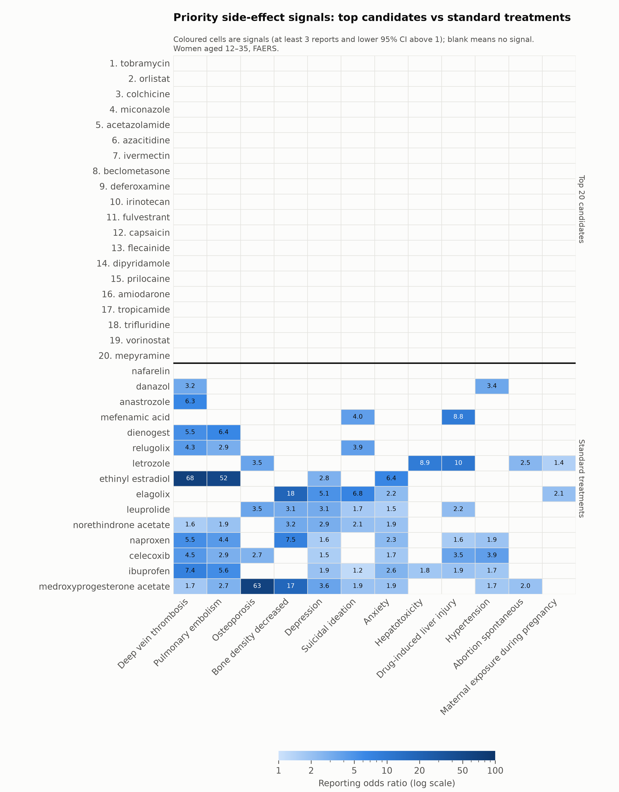
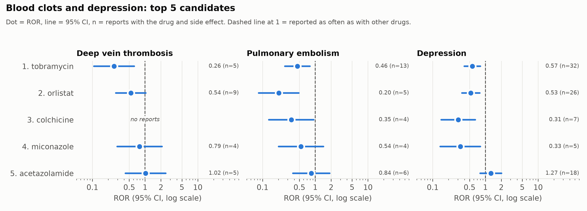
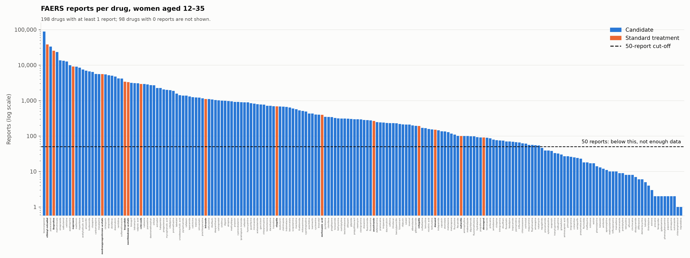

# Endometriosis Safety Screen

This project screens FDA side-effect reports for drugs that have been proposed as new endometriosis treatments, and compares them with the treatments patients already use. It focuses on women aged 12–35 and on side effects that matter for years of use, to produce a prioritised list of candidates for further research.

!! **This is a prioritized research list based on voluntary reports. It is not medical advice and does not show that any drug is safe.**

## Data sources

- **Side-effect reports:** the FDA Adverse Event Reporting System (FAERS), queried through the [openFDA drug event API](https://open.fda.gov/apis/drug/event/). Counts were downloaded on 22 October 2026.
- **Candidate drugs:** Supplementary Table S3 of Oskotsky et al. 2024, "Identifying therapeutic candidates for endometriosis through a transcriptomics-based drug repositioning approach", *iScience*.
- **Standard treatments:** 15 drugs already used for endometriosis (pain relievers, progestins, combined hormonal contraception, GnRH drugs, aromatase inhibitors and danazol).
- **Drug names:** standardised with the US National Library of Medicine's [RxNav API](https://lhncbc.nlm.nih.gov/RxNav/) (RxNorm).

## Population

Female patients aged 12–35 years at onset, all report years (openFDA: `patient.patientsex:2`, `patient.patientonsetage:[12 TO 35]`, `patient.patientonsetageunit:801`). This gives **1,124,641 reports**.

## Methods

1. **Drug list** (`make_drug_list.py`): all 299 unique candidates from Table S3, plus the 15 standard treatments. Three drugs on both lists (naproxen, mefenamic acid, letrozole) are kept only as standard.
2. **Name standardisation** (`standardize_names.py`): each drug is matched to an RxNorm ID and standard name. The 15 candidates with no match (lab compounds and drugs not approved in the US) are dropped, leaving 281 candidates and 15 standard drugs.
3. **Report counts** (`fetch_counts.py`): for the population and for each drug (matched on `patient.drug.openfda.generic_name`), the total number of reports and the count of each side effect (MedDRA preferred term). Drugs with fewer than 50 reports are labelled "not enough data"; 154 drugs have enough.
4. **Statistics** (`compute_ror.py`): for each drug and side effect, a 2×2 table of reports gives the reporting odds ratio, ROR = (a/b)/(c/d), with a 95% confidence interval on the log scale. A **signal** is at least 3 reports and a lower confidence limit above 1. P-values are adjusted for multiple testing with the Benjamini–Hochberg method.
5. **Ranking** (`rank.py`): drugs with enough data are ranked from fewest to most signals on 12 priority side effects (blood clots, bone loss, mood, liver injury, high blood pressure, pregnancy), with more reports breaking ties.
6. **Checks:** four well-known side effects (ethinyl estradiol with deep vein thrombosis and pulmonary embolism; leuprolide and elagolix with hot flush) are all detected as signals, and `tests/test_counts.py` confirms the ibuprofen total matches a query run by hand.

Every choice, with its reason, is recorded in [`decisions.md`](decisions.md).

## How to rerun everything

You need Python 3, an internet connection and a free [openFDA API key](https://open.fda.gov/apis/authentication/).

```bash
git clone https://github.com/nserene/endo-safety-screen.git
cd endo-safety-screen
python3 -m venv .venv
.venv/bin/python -m pip install -r requirements.txt
```

Then:

1. Put your API key in a file called `fda.env` in the project folder, on one line: `OPENFDA_API_KEY=your-key-here`. This file is excluded from Git.
2. Download Supplementary Table S3 (`mmc3.xlsx`) from the Oskotsky et al. 2024 paper and save it as `data/raw/mmc3.xlsx`. Raw files are not stored in this repository.
3. Run every step in order:

```bash
.venv/bin/python scripts/run_all.py
```

This takes a few minutes. openFDA responses are saved in `data/raw/openfda/`, so later reruns reuse them. openFDA adds new reports over time, so a fresh download may give slightly different counts, and the ibuprofen check in `tests/test_counts.py` (25,500 reports) will then fail.

## Figures

**Priority side-effect signals** ([`figures/heatmap_priority_signals.png`](figures/heatmap_priority_signals.png)): the ROR for each of the top 20 candidates and the 15 standard drugs on each priority side effect. Signals are coloured; other values are shown in grey.



**Blood clots and depression** ([`figures/forest_top5_clots_depression.png`](figures/forest_top5_clots_depression.png)): ROR with 95% confidence interval for the top 5 candidates on deep vein thrombosis, pulmonary embolism and depression.



**Reports per drug** ([`figures/bar_report_counts.png`](figures/bar_report_counts.png)): the number of reports for each drug, with the 50-report cut-off.



## Limitations

- **Voluntary reports.** FAERS shows that a side effect is reported unusually often with a drug, not that the drug causes it or how common it is. Most side effects are never reported, and publicity or lawsuits can make some reported far more often.
- **No signal does not mean safe.** Drugs with fewer reports have less chance of showing a signal, so drugs with few reports tend to rank higher. Drugs used as creams, inhalers or eye drops also reach the body less, which can make them look cleaner than they would as a pill.
- **Drug matching.** Drugs are matched on openFDA's `generic_name` field, which only covers drugs with a current US label. 98 drugs, mostly sold outside the US, have no reports and could not be assessed.
- **Confounding.** A side effect may be caused by the illness the drug treats or by another drug taken at the same time, not by the drug itself.
- **Missing age.** Reports without an age at onset are excluded, so the population is smaller than all reports about young women.
- **Duplicates.** The same event can be reported more than once (for example, by a patient and a doctor); duplicates were not removed.
- **Side-effect limit.** openFDA returns at most 1,000 side effects per query, so rare side effects have no population count and no ROR. All 12 priority side effects are within the limit.

## License

- **Code:** MIT License (see [`LICENSE`](LICENSE)).
- **Data and figures** (everything in `data/clean/` and `figures/`): [Creative Commons Attribution 4.0 (CC BY 4.0)](https://creativecommons.org/licenses/by/4.0/).

## How to cite

See [`CITATION.cff`](CITATION.cff), or use the "Cite this repository" button on GitHub.
DOI Links: https://doi.org/10.5281/zenodo.23654978
